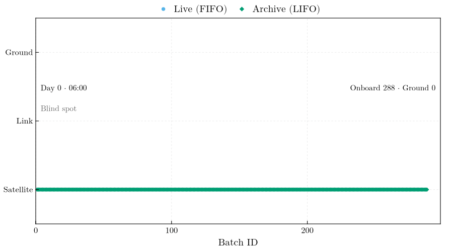

# Physics & Queuing Theory

`DeepSpaceTelemetry` models the telemetry environment of a deep-space science mission: a duty-cycled ground-station contact, a physical downlink with stochastic loss and scheduled disruptions, and the priority order in which data are sent to the ground. The telemetry, channel, and queuing layers are mission-agnostic; the shipped scenarios model the LISA mission.

## Virtual instrument (payload)
The telemetry layers do not read the payload: routing, loss, and delay depend on the batch cadence alone. In synthetic mode I therefore reduce the payload to a binary flag series, `0` on a segment holding noise only and `1` on a segment holding a flagged signal. A segment is flagged when its content span `[epoch, epoch + segment_duration_sec)` holds the instant of an event marker (`[[events.markers]]`), so the series is declared by the configuration and involves no random draw. Restricted to the rows that `RunAdapter.delivered_rows` returns at an instant, it states which samples of an event had reached the ground by then.

A physical noise or waveform model enters through `physics.data_source = "external"`: the series of a CSV file is cut into the same segments and passes through the same pipeline. Both sources are sampled on one grid anchored at the start of the initial blind spot, the content instant of the first sample. A generation gap or an emitter restart suppresses whole segments of that grid without shifting it, as the sampling clock of an instrument keeps its phase through an interruption of recording. A file with several columns is ingested as one payload (`physics.external_data_columns`), every column on the same grid and under one link accounting.

Every timestamp of a run (content epochs, event instants, the exported seconds) is referred to `simulation.start_sim_time`, a calendar instant without a time-scale attribution; the simulator carries no conversion between TCB and UTC. The LISA science ground segment conventions refer every time grid to the epoch `LISA_EPOCH_TCB` = 2035-01-01 00:00 TCB (Baghi et al. 2026, §7.1). The shipped scenarios therefore place their missions in 2035: most start on that calendar day, the seasonal cases later in the year.

## Bandwidth Profiling
Satellite-to-ground communication is constrained by the ground station's line of sight. The daily contact window opens at `telemetry.session_start` for `telemetry.session_duration_hours` (sessions crossing midnight are handled); outside it the capacity is zero, and within it the fractional capacity follows a selectable profile of the window progress `x ∈ [0, 1]`:
* `sine`: `sin²(πx)`, zero at both horizons, full capacity at culmination, 50 % on average.
* `sigmoid`: `[tanh(kx) + tanh(k(1 − x))] / 2` with `k = telemetry.sigmoid_steepness`, a fast rise at either horizon to a plateau of `tanh(k/2)` (0.9999 at the default `k = 10`). The edges are centered on the window boundaries, so the capacity at the session edges is ≈ 0.5: the profile models an abrupt acquisition.
* `gaussian`: `exp(−(x − ½)² / (2σ²))` with `σ = telemetry.gaussian_sigma`, a pass concentrated around culmination.
* `flat`: constant full capacity throughout the window.

A link at a fixed data rate, as the Report describes for LISA, is designed to close at the lowest elevation and holds its rate through the pass, which is the `flat` profile. The shaped profiles are stress abstractions of a partially usable pass. The budget of an X-band link varies by only a few dB between zenith and a 10° elevation mask, through atmospheric attenuation and noise temperature (DSN 810-005, module 105), so a capacity that falls to zero at the horizons has no link-budget basis. With the LISA rate pair and 8-hour passes the `sine` profile delivers about half of the daily production.

## Link Capacity and the 24-Hour Requirement
The link capacity is configured either as `telemetry.max_batches_per_hour`, the scenario abstraction, or physically as the downlink data rate `telemetry.downlink_kbps` against the on-board production rate `telemetry.onboard_data_rate_kbps`. In the physical form one batch of content span `D` takes `D · production / downlink` seconds at full capacity, and the catch-up ratio downlink / production is the number of hours of production that one hour of contact drains. At a lower capacity a transfer lasts until the capacity integrated from its start reaches that time, `∫ c(t) dt = D · production / downlink`; the capacity is zero outside the contact windows, so a transfer interrupted by the end of a pass or by a blackout resumes at the next contact. Contact windows are half-open, `[start, stop)`. The LISA Definition Study Report gives ≈ 75 kbit/s of production (Colpi et al. 2024, §6.3.2) and a 230 kbit/s downlink with communication windows of 8 hours per day (Table 6.2). Its requirement that data reach the ground within 24 hours of measurement demands more than 225 kbit/s at 8 hours of contact per day (§6.3.2), so the ratio of ≈ 3.07 leaves a margin of about 2 %.

The delivery-delay metric (`Metrology.delivery_delay_table`) reports, per run, the distribution of the delay from the end of each generated batch's content span to its arrival, and the fraction within `post_processing.delivery_requirement_hours`. `fraction_within` counts every generated batch, delivered or not. A batch generated less than the requirement before the end of the run is not yet due, and its delay cannot be judged within the run; `delivery_delay.csv` marks the due batches (`Due`), and `fraction_within_resolved` counts the batches due or delivered by the end of the run together with the batches the on-board recorder discarded at its ceiling, which never reach the ground.

## Contact Schedule and Low-Latency Periods
The daily window of `[telemetry]` generates the nominal passes; `[contacts]` shapes it. A seasonal term widens the window symmetrically about its center by `seasonal_extension_hours · ½ [1 + cos(2π (d − d_peak) / P)]`, with the day of year `d`, the peak day `season_peak_day_of_year`, and the period `season_period_days`. The term is evaluated on the calendar date of each pass. A mission spanning months sees its passes lengthen and shorten with the season, from the bare window half a period from the peak to the window plus the full extension at the peak; a year-long mission traverses the whole cycle. `simulation.start_sim_time` sets the phase at which the mission enters that cycle; with `seasonal_extension_hours = 0` the date has no effect on the passes. The day of year restarts on 1 January, so the term repeats from year to year only for a period of one year.

The Definition Study Report quotes pass durations of 8 to 12 hours over the year for the ESTRACK 35 m antennas (Colpi et al. 2024, §6.3.2), which the scenarios model as an 8-hour window with a 4-hour extension. The Report gives no peak day. The shipped scenarios take the phase from a northern-hemisphere 35 m station (Cebreros). The shipped scenarios take the constellation trailing Earth by 20°, as ESA's LISA factsheet describes it ("behind the Earth"). The Report allows either sense (±20°, Table 6.2), and its §6.2.1 counts a positive angle as leading and gives the baseline as 20°, which read literally is a leading constellation; the phase below rests on the factsheet. Trailing by 20°, the constellation sits about 80° east of the Sun, its geocentric declination peaks near day 89 and bottoms near day 276, and a northern station's pass is longest at the maximum, hence `season_peak_day_of_year = 89`; a southern station (Malargüe, New Norcia) would peak near day 276. A constellation leading by 20° sits about 80° west of the Sun, and the peak of a northern station moves to about day 255. The model keeps the Report's range and takes only the phase from this geometry: above a 10° elevation mask Cebreros alone sees the constellation for 6.9 h at the declination minimum and 12.9 h at the maximum, so the 8-hour floor is the Report's operational allocation (Table 6.2, §9.1.1) and not the visibility of one station.

Of the shipped scenarios, `recovery_12h_seasonal.toml` starts on 30 March (day 89: 12-hour passes, within minutes of the maximum throughout its week) and `long_30d_seasonal.toml` on 20 July (day 201, on the declining side: passes of about 9.3 h shortening to about 8.5 h over its thirty days). Every other scenario starts on 1 January 2035 with the term disabled, so the date does not act on its passes: 8 hours each, except the explicit pass list of `explicit_schedule.toml`.

`[[contacts.exceptions]]` state the window of a date as given (a zero duration is a missed pass). An explicit pass list, `[[contacts.passes]]` or a `schedule_csv` with the columns `Start, DurationHours`, replaces the generator altogether for planned schedules. Batches finalized inside a contact window are `LIVE` unless a full blackout holds the link at zero ([Link-Disruption Events](@ref)), and the capacity profile is evaluated at the position within the actual window, so an extended or shortened pass keeps its horizon-to-horizon shape.

Low-latency periods (`[[contacts.low_latency_periods]]`) are the extra contacts a mission arranges around a well-localized transient: quasi-real-time download outside the nominal pass, subject to station availability. Each period supplies a constant fraction of the peak capacity (`capacity_fraction`) for its duration and is an ordinary contact for the emitter (live classification) and the receiver (transfers). Where a period overlaps a nominal pass, the pass and its profile take precedence. The delivery-delay table flags batches that reached the ground inside a period, and the compliance summary counts them. A comparison with and without the periods takes a pair of runs differing only in `contacts.low_latency_enabled`, because the realized queue depends on the link history and cannot be replayed from one event log.

## Packet Loss Channel Models
Each batch transfer attempt on the downlink draws one loss realization from the configured `[packet_loss]` model:

* **Bernoulli**: memoryless i.i.d. loss with probability `p_loss`, the baseline.
* **Gilbert–Elliott**: the bursty-channel model of Gilbert (1960) and Elliott (1963). A two-state Markov chain alternates between a GOOD state (loss probability `p_loss_good`) and a BAD state (`p_loss_bad`). It starts in GOOD and makes one transition before each draw, at probabilities `p_good_to_bad` and `p_bad_to_good`. Its long-run loss rate is `π_bad·p_loss_bad + π_good·p_loss_good`, with `π_bad = p_good_to_bad / (p_good_to_bad + p_bad_to_good)` and `π_good = 1 − π_bad`; `stationary_loss_rate` returns it, and the test suite checks it against the sampled stream. The original models step the chain once per transmitted digit. Here it steps once per batch transfer attempt, so a burst lasts a number of attempts whatever their duration, and the state persists through the blind spots between passes. The shipped parameters are stress values and are not fitted to an X-band link.

A lost transfer leaves the batch on the link, and the whole batch is sent again. The loss is detected on the ground when the transfer completes, as in CFDP's deferred lost-segment detection, which issues the negative acknowledgment on receipt of the end-of-file PDU (CCSDS 727.0-B-5, §4.6.4.6). The retransmission can be served no earlier than one round-trip light time `2 · range / c` later, with the range from `telemetry.range_million_km` (≈ 334 s at 50 × 10⁶ km; `0` disables the delay). I model the other in-flight batches as served meanwhile, as concurrent CFDP transactions are; the link idles only when every in-flight batch is waiting for its round trip. After `max_retries + 1` failed transfers (the first attempt and `max_retries` retransmissions) the batch moves to `lost/` (data preserved, mask state `4`), which frees its in-flight slot on the link. `on_loss = "drop"` is shorthand for a zero-retry budget.

Whole-batch retransmission is an adaptation. CFDP requests only the missing segments, so the model charges each loss a full transfer time where the protocol would charge the lost frames. The delay statistics follow from the batch-level loss probability; the capacity consumed by retransmission is an upper bound. For scale, at the frame rejection rate of 10⁻⁴ to 10⁻⁵ that the DSN quotes as typical (DSN 820-100, §3.2.1.2), a 600 s LISA batch of about 5000 frames of 8920 bits holds a rejected frame with probability 0.4 to 0.05, while the rejected volume is 10⁻⁴ to 10⁻⁵ of the batch. With 2 % of margin at 8-hour passes, a batch-loss probability above that margin makes the backlog grow, which is the regime of the stress scenario.

The receiver records the outcome of a transfer (`ingested`, `retry`, `lost`) at its completion instant, and a transfer starts when the previous one has completed or later. The loss multiplier of a transfer is the largest of the disruption events active during it. A transfer that would complete at or after the mission horizon has no outcome: its batch stays on the link. Two simplifications remain. The range is held fixed over the mission; on the Report's baseline orbit it drifts between about 45 and 60 × 10⁶ km (Colpi et al. 2024, Figure 6.2 and §6.3.2). And the one-way light time is not modelled, so delivery delays and `L(δ)` are one one-way light time (≈ 167 s at 50 × 10⁶ km) short of the physical values.

## Link-Disruption Events
`[[disruption.events]]` entries superimpose scheduled link-degrading events on the daily visibility schedule: a spacecraft safe mode, for instance after a solar energetic particle event, or a ground-station outage. During the blackout phase the link capacity is multiplied by `1 − severity`; afterward it ramps linearly back to nominal over `recovery_hours`. Throughout blackout and recovery the stochastic loss probability is multiplied by `loss_multiplier` and clamped to `[0, 1]`; a multiplier below 1 has no effect. Overlapping events compose conservatively (minimum capacity, maximum loss multiplier).

The scenarios label their 18-hour outage a solar flare. Its physical reading is the safe mode that a solar particle event can trigger, since the Sun does not degrade this link through propagation: solar-plasma scintillation raises X-band frame errors only below a Sun–Earth–probe angle of about 2.3° (DSN 810-005, module 106, §2.2.1), and LISA stays about 80° from the Sun. The elevated loss of the recovery phase is a scenario parameter without a propagation basis.

The emitter gates transmission on the effective link, the geometric visibility times the disruption factor. Data generated while the effective link is zero, as in a full blackout, is stamped `ARCH_` and accumulates on board like blind-spot data, and the post-event drain follows the same LIVE-FIFO/ARCH-LIFO routing.

## Scheduled Generation Gaps and the On-Board Recorder
A disruption event with `affects = "generation"` interrupts data production instead of the link. It is the default for `type = "antenna_repointing"`: an antenna rotation is a planned interruption of science that degrades it for minutes afterward (Colpi et al. 2024, §6.3.2 and §9.1.1). The emitter produces nothing between the event start and `start + duration_hours`, discards the segments of the batch left incomplete at the gap start (as in an emitter outage, to keep the batch geometry uniform), and bounds the gap in `events_tx.csv` (`gap_start` / `gap_end`, Batch = `SCHEDULED`). Gap boundaries snap to segment boundaries; the severity, recovery, and loss keys of such an event are ignored. The downlink is unaffected: while the link is up, the emitter keeps placing buffered batches on it throughout the gap.

The on-board recorder holds `telemetry.onboard_capacity_days` of production (default 14 days, the Report's autonomy without ground contact; Colpi et al. 2024, §9.1.1), converted to a ceiling in batches through the batch content span. The emitter enforces it without eviction: a batch finalized while the buffer sits at the ceiling is discarded, the loss bounded by `gap_start` / `gap_end` rows with Batch = `RECORDER` (closed at the first finalization that finds room again). Configuration validation warns when the initial blind spot, or the longest interval without ground contact in the schedule, exceeds the capacity. The mission summary shades scheduled gaps and recorder overflows (a span narrower than 0.6 % of the plotted range is widened to that width so it stays visible) and draws the capacity on the buffer axis when it was reached.

## Queuing Theory: LIFO vs FIFO
Between contacts the spacecraft accumulates a backlog (16 blind hours per day under the 8 h passes of most shipped LISA scenarios). When the link opens, the satellite routes data as a two-class priority queue whose classes are served FIFO and LIFO (Kleinrock 1976, §3.5 and §3.6; non-preemptive priorities after Cobham 1954). Service is non-preemptive: a transfer in service completes before the next selection. The ordering is a design choice of this package. The LISA documents state a 24-hour delivery requirement and low-latency periods, and no downlink order.

1. **Near-real-time (live) data:** highest priority, sent first-in, first-out (FIFO) so the ground sees the newest observations with the smallest latency.
2. **Archive backfill (LIFO):** the remaining bandwidth drains the backlog last-in, first-out, newest archived data first. For a transient caught live (in the LISA case a massive black-hole binary merger), the archived data immediately preceding it are the most valuable: the sky localization of such a binary improves rapidly in the last hours before merger (Colpi et al. 2024, Figure 9.2). LIFO delivery lets alert pipelines extend the waveform backward from the live event without a gap.

The receiver selects among the batches on the link, and the emitter places a batch there only while fewer than `max_inflight_batches` are in flight. A live batch finalized while that window is full can therefore wait one archive transfer longer than head-of-the-line priority would allow.

The doctrine batch by batch, over one run of `scenarios/stress_8h_bursty.toml`.
Each row is a stage (buffered on the satellite, in flight on the link,
delivered on the ground), and the color gives the routing family, sky blue
for live (FIFO) and green for archive (LIFO); the marker shape repeats the
distinction. Live batches cross to the ground as they are generated, so the
sky-blue runs mark the passes; between them the archive segment grows
backward in batch identifier, contiguous with the live tail, which is the
LIFO backfill. Through the blackout the ground row stands still while the
onboard block extends to the right. The status line carries the mission
clock (`Day N` counts elapsed days, as on the summary axis, and the time of
day is that of the session figures), the link state, and the buffer
counters of that frame.

## Alert-Latency Metrology
The alert-latency metric measures the effect of the LIFO backfill from the event logs (`Metrology.alert_latency_table`). Every live batch that reached the ground, and that the counterfactual drain below reaches within the mission, defines an alert: the event instant `t_m` is the content end of that batch (the moment the transient's samples exist on board). For a look-back `δ`, the window `[t_m − δ, t_m)` together with the alert batch itself is complete on the ground once every batch overlapping it has arrived; the latency `L(δ)` is that completion instant minus `t_m`, so `L(δ ≤ D)` is the delivery delay of the live batch itself and `L(δ)` is non-decreasing for each alert. Under the realized doctrine the arrival instants are the recorded `ingested` events. The counterfactual first-in, first-out drain assigns the same successful transfers (the sorted `ingested` instants, with their link, slots and losses) to the batches in content order: each goes to the oldest batch already generated and still undelivered, with no live priority. The table reports the median and the interquartile band of `L(δ)` over all alerts on the grid `δ = 0, D, 2D, …` (`D` = batch content span) up to `post_processing.alert_lookback_hours`.

An alert whose window reaches before the first batch is left out at that `δ`. A window that holds a batch that had not arrived by the end of the run is censored: its latency exceeds the time from `t_m` to the end of the run. A window that holds data the on-board recorder discarded never completes. The table carries two estimates. The complete-case quantiles (`LIFO_Median_Hours` and the like, population `N_Alerts`) use the alerts whose windows completed under both doctrines; the population shrinks with `δ`, so these medians need not be monotone, and in a run that ends with a backlog they understate the latency of the alerts they exclude. The product-limit (Kaplan–Meier) quantiles (`LIFO_KM_Median_Hours` and the like, population `N_Alerts_All`, censored counts `N_Censored_LIFO` and `N_Censored_FIFO`) use every live batch delivered under the realized doctrine (Kaplan & Meier 1958); a quantile that the estimate does not reach within the run is reported as `NaN`. The estimator assumes censoring independent of the latency, which a backlog at the end of the run violates in part, since late alerts are censored early. The figure draws the product-limit estimates.

Under LIFO the window fills backward from the live stream. For an alert `τ` hours into a pass, the pass has already delivered the live data since its start and archive data reaching about `(c − 1)·τ` further back, `c` the catch-up ratio net of retransmissions, so `L(δ)` stays at `L(0)` up to `δ ≈ c·τ`. Beyond that it grows with slope `1/(c − 1)` (about 0.5 h per hour of look-back on the LISA link). Each time the backfill continues into a later pass it steps up by the blind spot `B` before that pass and by the time to drain it, since the newer blind-spot data go first under LIFO: `B + B/(c − 1) = B·c/(c − 1)`, about 18 h for a 12-hour blind spot at `c ≈ 3.07`. Under FIFO the newest batches of the window arrive last, so `L(δ)` sits near the time needed to drain the whole backlog generated before the event.

Event markers (`[[events.markers]]`) are the instants of interest a scenario declares, such as a transient or a glitch. The alert latency is evaluated at each of them as well (`Metrology.marker_latency_table`), with the batch whose content span holds the marker as the alert batch and the marker instant as `t_m`; each marker's `L(δ)` is written to `alert_latency_markers.csv` and drawn over the population bands. The end-to-end alert latency adds the ground processing budget `ground.processing_latency_hours`, which the figure annotates. Its default of 1 h is the Report's requirement that the low-latency alert pipeline finish within one hour of the L0 data reaching the ground stations (Colpi et al. 2024, §8.5); the Report's end-to-end figure is a total latency below 1 h from data generation to updated source parameters inside a low-latency period (§9.1.1). A marker may also trigger a low-latency period `low_latency_after_hours` after its instant ([Contact Schedule and Low-Latency Periods](@ref)). The emitter stamps the labels of the markers held by a batch into its `metadata.json` and appends a `marker` row to `events_tx.csv` when that batch is finalized.

## Mission Clocks: Wall and Tick

`simulation.mode` selects one of two clocks. The physics (contact windows,
capacity profile, loss channel, the round-trip deferral of retransmissions,
the recorder ceiling, the routing doctrine) is written in mission time and
is the same under both. The clocks differ only in how mission time advances.

Both modes run on one driver (`TelemetryCore.run_ticks!`). The emitter and
the receiver are cooperative tasks on one thread: each task computes the
mission instant it next needs (the end of the segment being observed, the
completion of a download slot, the earliest deferred retransmission) and
parks; when every task is parked the clock jumps to the earliest request
and releases that task alone. The record is therefore a deterministic
function of the configuration and the seed in both modes. In both modes the
driver refreshes the liveness files `emitter_alive` and `receiver_alive`
and applies the `[supervision]` policy to a component that fails.

**Wall mode** (`"wall"`, the default and the operational mode) paces the
driver against the wall clock: before releasing a wakeup at mission instant
`t` it sleeps until `speed_up` mission seconds per wall second have passed
since the start, for a span of `speed_up · mission_wall_seconds`. A consumer
developed against an accelerated run follows a real-time rehearsal
(`speed_up = 1`) unchanged. The wall budget is nominal: a host that lags
releases late and finishes later, with the same content.

**Tick mode** (`"tick"`, the analysis mode) runs the driver unpaced: nothing
sleeps and the run takes as long as its events take to process. The span is
`mission_days`; `speed_up` and `mission_wall_seconds` have no meaning and
are rejected, as is the console status panel, and the dashboard launcher
refuses the mode. The run directory, the sentinels, and every product are
those of a wall run; `clock_anchor.toml` records the mode and the horizon,
and for a wall run the speed-up and the nominal wall deadline as well.

At an equal instant the emitter runs before the receiver
(`TelemetryCore.EMITTER_PRIORITY`, `RECEIVER_PRIORITY`), because the
instrument delivers a segment after observing it and the ground serves
what is on the link once it is there. A task's own requests are released
in registration order. These two rules make the schedule total. The
receiver's idle wait resumes after the emitter's next wakeup, since the
link changes only when the emitter runs. Its wait for a deferred
retransmission also ends at the emitter's next wakeup, and a batch placed
on the link in the meantime is served without waiting out the round trip
(`TelemetryCore.wait_until_or_change!`). At the horizon the clock stops: a
segment whose content interval ends at the horizon is not generated, a
transfer that would complete at or after the horizon has no outcome, and
both tasks leave at their next iteration.

On one platform and one Julia version, two runs of the same configuration
and seed produce the same `events_tx.csv`, `events_rx.csv`, mask timeline,
batch epochs, and metrics profile apart from its `WallTime` column. A wall
run gives the same record as the tick run of the same configuration with
`mission_days = speed_up · mission_wall_seconds / 86 400`. The test suite
asserts both, and asserts the production count from the span alone. Across
platforms the record should agree as well, since routing, counts, and
event order follow from integer arithmetic on the millisecond grid and from
the Xoshiro stream of the loss channel.

## References

- Baghi, Q., Babak, S., Barack, L., et al., *LISA science ground segment conventions*, LISA-DDPC-SEG-TN-007, issue 1 revision 10 (2026), [arXiv:2603.22377v1](https://arxiv.org/abs/2603.22377v1), [doi:10.48550/arXiv.2603.22377](https://doi.org/10.48550/arXiv.2603.22377).
- CCSDS, *CCSDS File Delivery Protocol (CFDP)*, Recommended Standard CCSDS 727.0-B-5, Blue Book, Issue 5 (2020).
- Cobham, A., *Priority assignment in waiting line problems*, Journal of the Operations Research Society of America **2**, 70–76 (1954), [doi:10.1287/opre.2.1.70](https://doi.org/10.1287/opre.2.1.70).
- Colpi, M., et al., *LISA Definition Study Report*, ESA-SCI-DIR-RP-002 (2024), [arXiv:2402.07571](https://arxiv.org/abs/2402.07571), [doi:10.48550/arXiv.2402.07571](https://doi.org/10.48550/arXiv.2402.07571).
- Elliott, E. O., *Estimates of error rates for codes on burst-noise channels*, Bell System Technical Journal **42**, 1977–1997 (1963), [doi:10.1002/j.1538-7305.1963.tb00955.x](https://doi.org/10.1002/j.1538-7305.1963.tb00955.x).
- ESA, *LISA factsheet*, [esa.int/Science_Exploration/Space_Science/LISA_factsheet](https://www.esa.int/Science_Exploration/Space_Science/LISA_factsheet).
- Gilbert, E. N., *Capacity of a burst-noise channel*, Bell System Technical Journal **39**, 1253–1265 (1960), [doi:10.1002/j.1538-7305.1960.tb03959.x](https://doi.org/10.1002/j.1538-7305.1960.tb03959.x).
- Jet Propulsion Laboratory, *Deep Space Network Services Catalog*, DSN No. 820-100, Rev. H (2022), [deepspace.jpl.nasa.gov/files/820-100-H.pdf](https://deepspace.jpl.nasa.gov/files/820-100-H.pdf).
- Jet Propulsion Laboratory, *DSN Telecommunications Link Design Handbook*, DSN No. 810-005: module 105, *Atmospheric and Environmental Effects*; module 106, Rev. B, *Solar Corona and Solar Wind Effects* (2010), [deepspace.jpl.nasa.gov/dsndocs/810-005](https://deepspace.jpl.nasa.gov/dsndocs/810-005/).
- Kaplan, E. L., Meier, P., *Nonparametric estimation from incomplete observations*, Journal of the American Statistical Association **53**, 457–481 (1958), [doi:10.1080/01621459.1958.10501452](https://doi.org/10.1080/01621459.1958.10501452).
- Kleinrock, L., *Queueing Systems, Volume II: Computer Applications*, Wiley, New York (1976), ISBN 0-471-49111-X.
