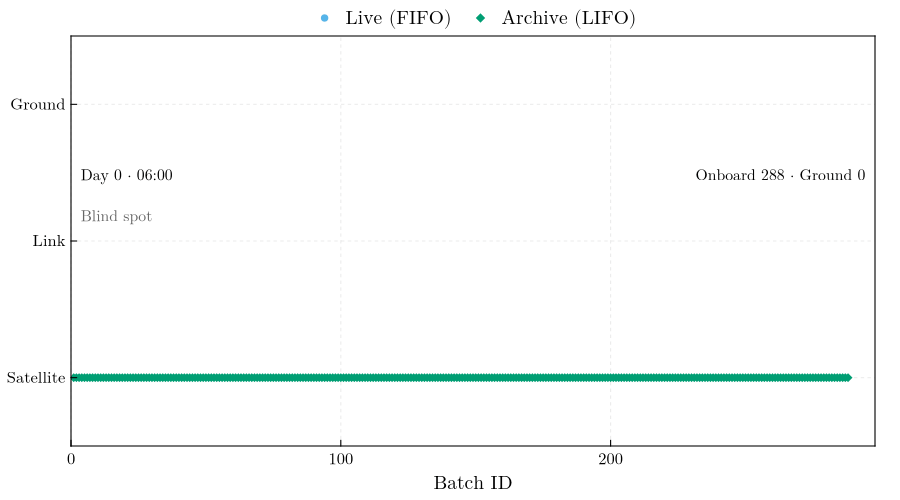

# Physics & Queuing Theory

`DeepSpaceTelemetry` models the telemetry environment of a deep-space science mission: a duty-cycled ground-station contact, a physical downlink with stochastic loss and scheduled disruptions, and the routing doctrine that decides which data reach the ground first. The telemetry, channel, and queuing layers are mission-agnostic; the shipped scenarios model the LISA mission.

## Virtual instrument (payload)
The telemetry layers do not read the payload: routing, loss, and delay depend on the batch cadence alone. In synthetic mode I therefore reduce the payload to a binary flag series, `0` on a segment holding noise only and `1` on a segment holding a flagged signal. A segment is flagged when its content span `[epoch, epoch + segment_duration_sec)` holds the instant of an event marker (`[[events.markers]]`), so the series is declared by the configuration and involves no random draw. Multiplied by a delivery mask, it states directly which samples of an event had reached the ground at a given time.

A physical noise or waveform model enters through `physics.data_source = "external"`: the series of a CSV file is cut into the same segments and passes through the same pipeline. Both sources are sampled on one grid anchored at the start of the initial blind spot, the content instant of the first sample. A generation gap or an emitter restart suppresses whole segments of that grid without shifting it, as the sampling clock of an instrument keeps its phase through an interruption of recording. A file with several columns is ingested as one payload (`physics.external_data_columns`), every column on the same grid and under one link accounting.

Every timestamp of a run (content epochs, event instants, the exported seconds) is referred to `simulation.start_sim_time`, a calendar instant without a time-scale attribution; the simulator carries no conversion between TCB and UTC. The LISA science ground segment conventions refer every time grid to the epoch `LISA_EPOCH_TCB` = 2035-01-01 00:00 TCB (Baghi et al. 2026, §7.1). The shipped scenarios therefore place their missions in 2035: most start on that calendar day, the seasonal cases later in the year.

## Bandwidth Profiling
Satellite-to-ground communication is constrained by the ground station's line of sight. The daily contact window opens at `telemetry.session_start` for `telemetry.session_duration_hours` (sessions crossing midnight are handled); outside it the capacity is zero, and within it the fractional capacity follows a selectable profile of the window progress `x ∈ [0, 1]`:
* `sine`: `sin²(πx)` — zero at both horizons, full capacity at culmination, 50 % on average.
* `sigmoid`: `[tanh(kx) + tanh(k(1 − x))] / 2` with `k = telemetry.sigmoid_steepness`, a fast horizon breach to sustained peak capacity. The logistic edges are centered on the window boundaries, so the capacity at the exact session edges is ≈ 0.5 rather than 0: the profile models an abrupt acquisition, not a rise from zero.
* `gaussian`: `exp(−(x − ½)² / (2σ²))` with `σ = telemetry.gaussian_sigma` — a pass concentrated around culmination.
* `flat`: constant full capacity throughout the window.

## Link Capacity and the 24-Hour Requirement
The link capacity is configured either as `telemetry.max_batches_per_hour` — the scenario abstraction — or physically as the downlink data rate `telemetry.downlink_kbps` against the on-board production rate `telemetry.onboard_data_rate_kbps`: one batch of content span `D` then takes `D · production / downlink` seconds at full capacity, and the catch-up ratio downlink / production states how many hours of production one hour of contact drains. The LISA Definition Study Report gives ≈ 75 kbit/s of production and a 230 kbit/s downlink with 8-hour daily passes (Colpi et al. 2024, §6.3.2); its requirement that data reach the ground within 24 hours of measurement alone demands more than 225 kbit/s at 8 hours of contact per day, so the ratio of ≈ 3.07 leaves a margin of about 2 %. The delivery-delay metric (`Metrology.delivery_delay_table`) reports, per run, the distribution of the measurement-to-ground delay of every generated batch and the fraction within `post_processing.delivery_requirement_hours` (undelivered batches count as non-compliant).

## Contact Schedule and Low-Latency Periods
The daily window of `[telemetry]` generates the nominal passes; `[contacts]` shapes it. A seasonal term widens the window symmetrically about its center by `seasonal_extension_hours · ½ [1 + cos(2π (d − d_peak) / P)]`, with the day of year `d`, the peak day `season_peak_day_of_year`, and the period `season_period_days`. The Definition Study Report quotes 8 to 12 hours over the year for the ESTRACK antennas (Colpi et al. 2024, §6.3.2), i.e. an 8-hour window with a 4-hour extension. The Report gives no peak day. The shipped scenarios take the daily pass from a northern-hemisphere 35 m station (Cebreros): a constellation trailing Earth by 20° sits about 80° east of the Sun, so its geocentric declination peaks near day 89 and bottoms near day 276, and a northern station's pass is longest at the maximum, hence `season_peak_day_of_year = 89`; a southern station (Malargüe, New Norcia) would peak near day 276. `[[contacts.exceptions]]` state the window of a date verbatim (a zero duration is a missed pass). An explicit pass list, `[[contacts.passes]]` or a `schedule_csv` with the columns `Start, DurationHours`, replaces the generator altogether for planned schedules. Batches finalized inside any contact window are `LIVE`, and the capacity profile is evaluated at the position within the actual window, so an extended or shortened pass keeps its horizon-to-horizon shape.

Low-latency periods (`[[contacts.low_latency_periods]]`) are the extra contacts a mission arranges around a well-localized transient: quasi-real-time download outside the nominal pass, subject to station availability. Each period supplies a constant fraction of the peak capacity (`capacity_fraction`) for its duration and is an ordinary contact for the emitter (live classification) and the receiver (transfers). The delivery-delay table flags batches that reached the ground inside a period, and the compliance summary counts them. A comparison with and without the periods takes a pair of runs differing only in `contacts.low_latency_enabled`, because the realized queue depends on the link history and cannot be replayed from one event log.

## Packet Loss Channel Models
Each batch transfer attempt on the downlink draws one loss realization from the configured `[packet_loss]` model:

* **Bernoulli**: memoryless i.i.d. loss with probability `p_loss` — the textbook baseline.
* **Gilbert–Elliott**: the canonical bursty-channel model (Gilbert 1960; Elliott 1963). A two-state Markov chain alternates between a GOOD state (loss probability `p_loss_good`) and a BAD state (`p_loss_bad`), with one transition per attempt at probabilities `p_good_to_bad` and `p_bad_to_good`. Its analytic long-run loss rate is `π_bad·p_loss_bad + π_good·p_loss_good`, with `π_bad = p_good_to_bad / (p_good_to_bad + p_bad_to_good)` and `π_good = 1 − π_bad`; `stationary_loss_rate` returns it, and the test suite checks it against the sampled stream.

A lost transfer leaves the batch on the link. The loss is detected on the ground when the transfer completes, and the retransmission can be served no earlier than one round-trip light time `2 · range / c` later, with the range from `telemetry.range_million_km` (≈ 334 s at 50 × 10⁶ km; `0` disables the delay). I model the other in-flight batches as served meanwhile, as under a deferred negative-acknowledgment protocol (the deferred-NAK mode of CFDP, CCSDS 727.0-B-5); the link idles only when every in-flight batch is waiting for its round trip. After `max_retries` failures the batch moves to `lost/` (data preserved, mask state `4`), which frees its in-flight slot on the link. `on_loss = "drop"` is shorthand for a zero-retry budget. The one-way light time is not modelled: a transfer counts as on the ground when its service completes, so delivery delays and `L(δ)` are one one-way light time (≈ 167 s at 50 × 10⁶ km) short of the physical values, and the range is held fixed over the mission.

## Link-Disruption Events
`[[disruption.events]]` entries superimpose scheduled link-degrading events (solar flares, spacecraft safe-mode entries, ground-station outages) on the daily visibility schedule. During the blackout phase the link capacity is multiplied by `1 − severity`; afterward it ramps linearly back to nominal over `recovery_hours`. Throughout blackout *and* recovery the stochastic loss probability is multiplied by `loss_multiplier`, the product clamped to `[0,1]`, which models the noisy, marginal link of a recovering channel. Overlapping events compose conservatively (minimum capacity, maximum loss multiplier).

The emitter gates transmission on the *effective* link, the geometric visibility times the disruption factor. Data generated while the effective link is zero, as in a full blackout, is therefore stamped `ARCH_` and accumulates onboard like blind-spot data, and the post-event drain follows the same LIVE-FIFO/ARCH-LIFO routing.

## Scheduled Generation Gaps and the On-Board Recorder
A disruption event with `affects = "generation"` (the default for `type = "antenna_repointing"`, the minutes-long science interruptions of the antenna rotation; Colpi et al. 2024, §6.3.2) interrupts data production instead of the link: the emitter produces nothing between the event start and `start + duration_hours`, discards the segments of the batch left incomplete at the gap start (as in an emitter outage, so batch geometry stays uniform), and bounds the gap in `events_tx.csv` (`gap_start` / `gap_end`, Batch = `SCHEDULED`). Gap boundaries snap to segment boundaries; the severity, recovery, and loss keys of such an event are ignored. The downlink is unaffected: while the link is up, the emitter keeps placing buffered batches on it throughout the gap.

The on-board recorder holds `storage.onboard_capacity_days` of production (default 14 days, the Report's autonomy without ground contact; Colpi et al. 2024, §9.1.1), i.e. a ceiling in batches through the batch content span. The emitter enforces it without eviction: a batch finalized while the buffer sits at the ceiling is discarded, the loss bounded by `gap_start` / `gap_end` rows with Batch = `RECORDER` (closed at the first finalization that finds room again). Configuration validation warns when the initial blind spot, or the longest interval without ground contact in the schedule, exceeds the capacity. The mission summary shades scheduled gaps and recorder overflows (a span narrower than 0.6 % of the plotted range is widened to that width so it stays visible) and draws the capacity on the buffer axis when it was reached.

## Queuing Theory: LIFO vs FIFO
Between contacts the spacecraft accumulates a backlog (16 blind hours per day under the 8 h passes of most shipped LISA scenarios). When the link opens, the satellite routes data under a strict priority doctrine — a two-class priority queue whose classes are served FIFO and LIFO in the sense of Kleinrock (1976), with non-preemptive service: a transfer in service completes before the next selection:

1. **Near-real-time (live) data:** highest priority, sent first-in, first-out (FIFO) so the ground sees the newest observations with the smallest latency.
2. **Archive backfill (LIFO):** the remaining bandwidth drains the backlog last-in, first-out — the newest archived data first. For a transient caught live (in the LISA case a massive black-hole binary merger), the archived data immediately preceding it are the most valuable, and LIFO delivery lets alert pipelines extend the waveform backward from the live event without a gap.

The doctrine batch by batch, over one run of `scenarios/stress_8h_bursty.toml`.
Each row is a stage — buffered on the satellite, in flight on the link,
delivered on the ground — and the color the routing family: sky blue live
(FIFO), green archive (LIFO), with the marker shape repeating the
distinction. Live batches cross to the ground as they are generated, so the
sky-blue runs mark the passes; between them the archive segment grows
backward in batch identifier, contiguous with the live tail, which is the
LIFO backfill. Through the blackout the ground row stands still while the
onboard block extends to the right. The status line carries the mission
clock (`Day N` counts elapsed days, as on the summary axis, and the time is
the mission clock, as on the session figures), the link state, and the
buffer counters of that frame.

## Alert-Latency Metrology
The alert-latency metric measures the effect of the LIFO backfill from the event logs (`Metrology.alert_latency_table`). Every live batch that reached the ground defines an alert: the event instant `t_m` is the content end of that batch (the moment the transient's samples exist on board). For a look-back `δ`, the window `[t_m − δ, t_m)` together with the alert batch itself is complete on the ground once every batch overlapping it has arrived; the latency `L(δ)` is that completion instant minus `t_m`, so `L(δ ≤ D)` is the delivery delay of the live batch itself and `L(δ)` is non-decreasing. Under the realized doctrine the arrival instants are the recorded `ingested` events. The counterfactual first-in, first-out drain re-assigns the very same service completions — the sorted `ingested` instants, i.e. the same link, the same slots, the same losses — to the batches in content order, each completion going to the oldest batch already generated and still undelivered, with no live priority. The table reports the median and the interquartile band of `L(δ)` over all alerts on the grid `δ = 0, D, 2D, …` (`D` = batch content span) up to `post_processing.alert_lookback_hours`; alerts whose window reaches before the first batch, or contains a batch that never arrived, are excluded at that `δ`. Under LIFO the window fills backward from the live stream, so `L(δ)` grows linearly in `δ`, with a slope set by the archive drain rate; under FIFO the newest batches of the window arrive last, so `L(δ)` sits near the time needed to drain the whole backlog generated before the event.

Event markers (`[[events.markers]]`) are the instants of interest a scenario declares — a transient, a glitch — and the alert latency is evaluated at each of them as well (`Metrology.marker_latency_table`): the alert batch is the one whose content span holds the marker, `t_m` is the marker instant itself, and every marker's `L(δ)` is written to `alert_latency_markers.csv` and drawn over the population bands. The end-to-end alert latency adds the ground processing budget `ground.processing_latency_hours` (default 1 h, a modelling budget; the Report quotes a total latency below 1 h from data generation to updated source parameters inside a low-latency period, Colpi et al. 2024, §9.1.1), which the figure annotates; a marker may also trigger a low-latency period `low_latency_after_hours` after its instant (Contact Schedule above). The emitter stamps the labels of the markers held by a batch into its `metadata.json` and appends a `marker` row to `events_tx.csv` when that batch is finalized.

## Mission Clocks: Wall and Tick

`simulation.mode` selects one of two clocks. The physics (contact windows,
capacity profile, loss channel, the round-trip deferral of retransmissions,
the recorder ceiling, the routing doctrine) is written in mission time and
is the same under both. The clocks differ only in how mission time advances.

Both modes run on one driver (`TelemetryCore.run_ticks!`). The emitter and
the receiver are cooperative tasks on one thread: each task computes the
mission instant it next needs (the end of the segment being observed, the
completion of a download slot, the earliest deferred retransmission) and
parks; when every task is parked the clock jumps to the earliest request
and releases that task alone. The record is therefore a deterministic
function of the configuration and the seed in both modes.

**Wall mode** (`"wall"`, the default and the operational mode) paces the
driver against the wall clock: before releasing a wakeup at mission instant
`t` it sleeps until `speed_up` mission seconds per wall second have passed
since the start, for a span of `speed_up · mission_wall_seconds`. A consumer
developed against an accelerated run follows a real-time rehearsal
(`speed_up = 1`) unchanged. The wall budget is nominal: a host that lags
releases late and finishes later, with the same content. The driver also
refreshes the liveness files `emitter_alive` and `receiver_alive` and
restarts a component that fails, under `[supervision]`.

**Tick mode** (`"tick"`, the analysis mode) runs the driver unpaced: nothing
sleeps and the run takes as long as its events take to process. The span is
`mission_days`; `speed_up` and `mission_wall_seconds` have no meaning and
are rejected, as is the console status panel, and the dashboard launcher
refuses the mode. The run directory, the sentinels, and every product are
those of a wall run; `clock_anchor.toml` records the mode and the horizon,
and for a wall run the speed-up and the nominal wall deadline as well.

Two rules make the schedule total. At an equal instant the emitter runs
before the receiver (`TelemetryCore.EMITTER_PRIORITY`,
`RECEIVER_PRIORITY`): the instrument delivers a segment after observing
it, and the ground serves what is on the link once it is there — a
semantic choice. Among a task's own requests, registration order decides. The
receiver's idle wait resumes after the emitter's next wakeup, since the
link changes only when the emitter runs, and its wait for a deferred
retransmission is cut short by the emitter's activity in the same way, so a
batch placed on the link in the meantime is served without waiting out the
round trip (`TelemetryCore.wait_until_or_change!`). At the horizon the
clock stops: a segment whose content interval ends at the horizon is not
generated, a transfer in service at the horizon completes in the record at
its start instant, and both tasks leave at their next iteration.

What the mode guarantees, and what it does not. On one platform and one
Julia version, two runs of the same configuration and seed produce the
same `events_tx.csv`, `events_rx.csv`, mask timeline, batch epochs, and
metrics profile apart from its wall-clock column. The test suite asserts
exactly this, and asserts the production count from the span alone. Across
platforms the record should agree as well: routing, counts, and event
order follow from integer arithmetic on the millisecond grid and from the
Xoshiro stream of the loss channel. A wall run and the tick run of the same
configuration, with `mission_days = speed_up · mission_wall_seconds / 86 400`,
produce the same record; the suite asserts this too. Only the `WallTime`
column of the metrics profile tells them apart.

## References

- Baghi, Q., Babak, S., Barack, L., et al., *LISA science ground segment conventions*, LISA-DDPC-SEG-TN-007, issue 1 revision 10 (2026), [arXiv:2603.22377](https://arxiv.org/abs/2603.22377), [doi:10.48550/arXiv.2603.22377](https://doi.org/10.48550/arXiv.2603.22377).
- Colpi, M., et al., *LISA Definition Study Report*, ESA-SCI-DIR-RP-002 (2024), [arXiv:2402.07571](https://arxiv.org/abs/2402.07571), [doi:10.48550/arXiv.2402.07571](https://doi.org/10.48550/arXiv.2402.07571).
- Elliott, E. O., *Estimates of error rates for codes on burst-noise channels*, Bell System Technical Journal **42**, 1977–1997 (1963), [doi:10.1002/j.1538-7305.1963.tb00955.x](https://doi.org/10.1002/j.1538-7305.1963.tb00955.x).
- Gilbert, E. N., *Capacity of a burst-noise channel*, Bell System Technical Journal **39**, 1253–1265 (1960), [doi:10.1002/j.1538-7305.1960.tb03959.x](https://doi.org/10.1002/j.1538-7305.1960.tb03959.x).
- Kleinrock, L., *Queueing Systems, Volume II: Computer Applications*, Wiley, New York (1976), ISBN 0-471-49111-X.
- CCSDS, *CCSDS File Delivery Protocol (CFDP)*, Recommended Standard CCSDS 727.0-B-5, Blue Book (2020).
