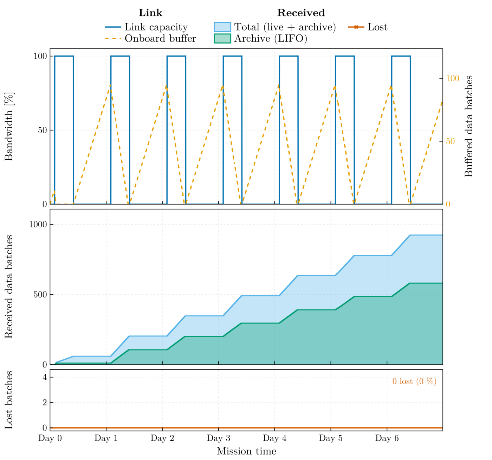
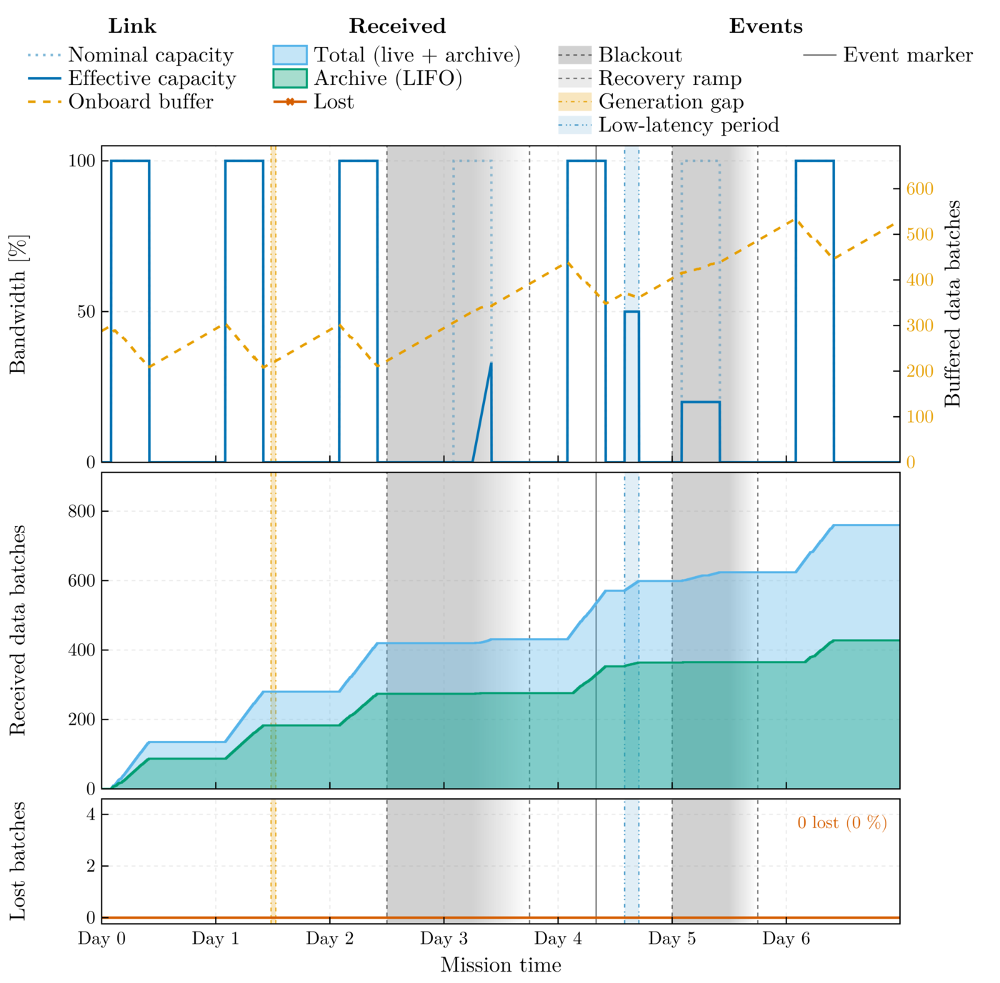
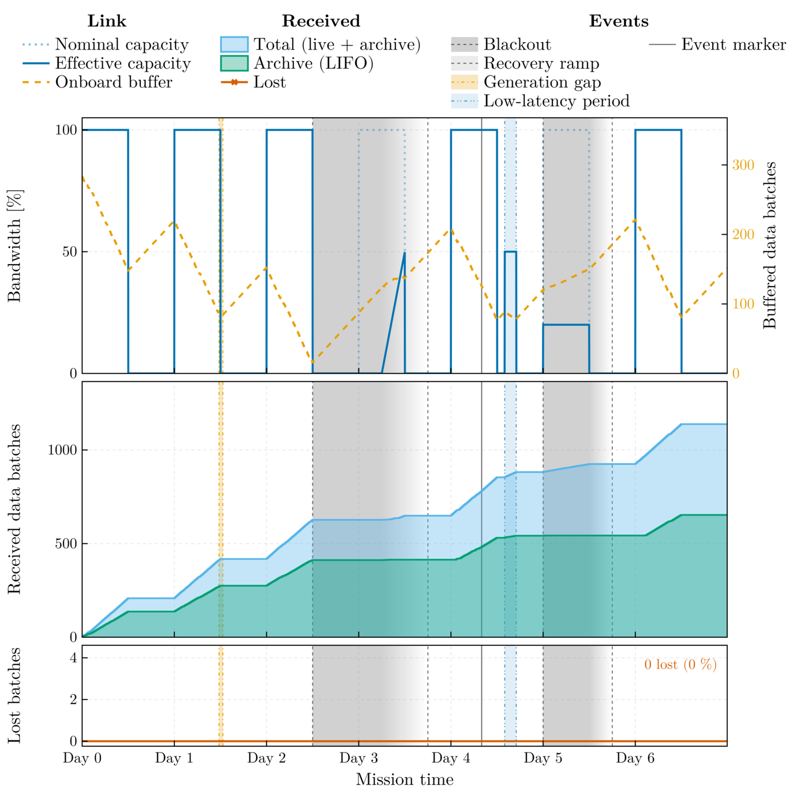
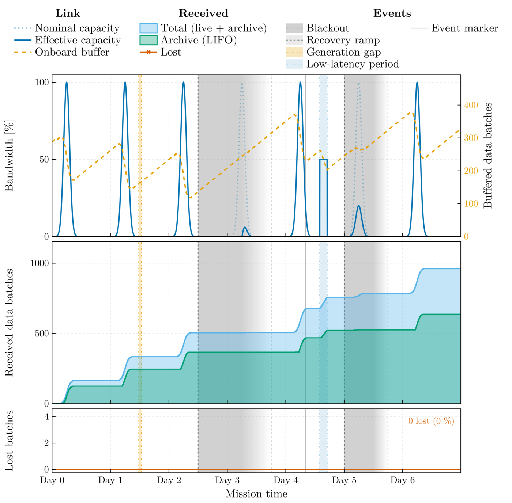
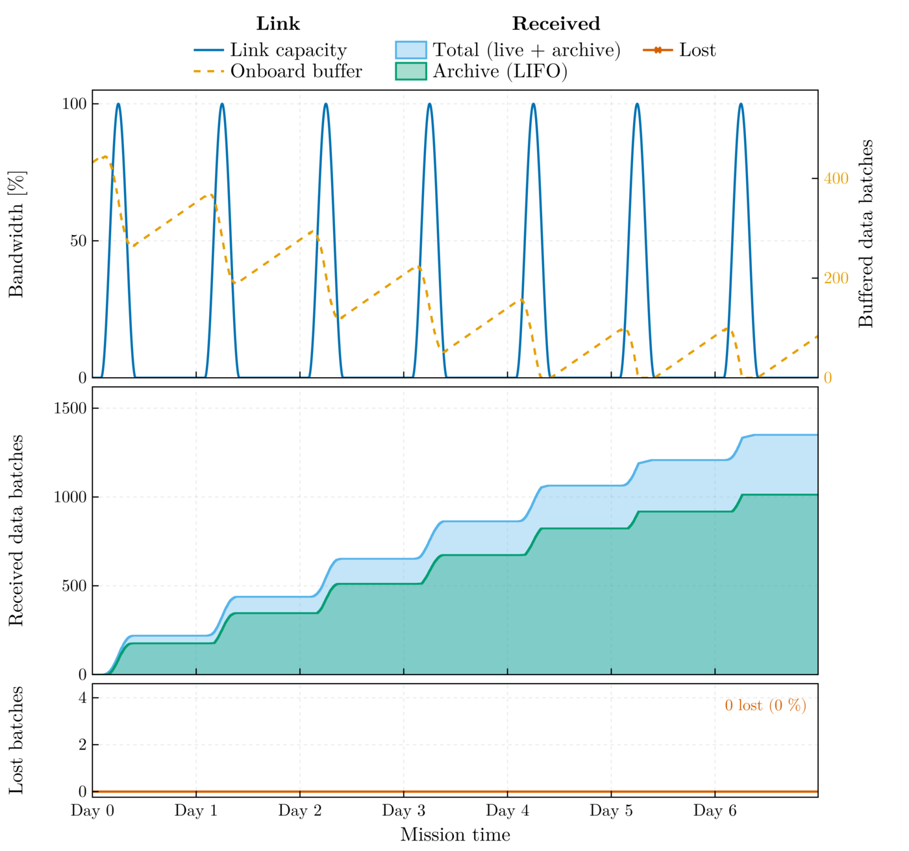
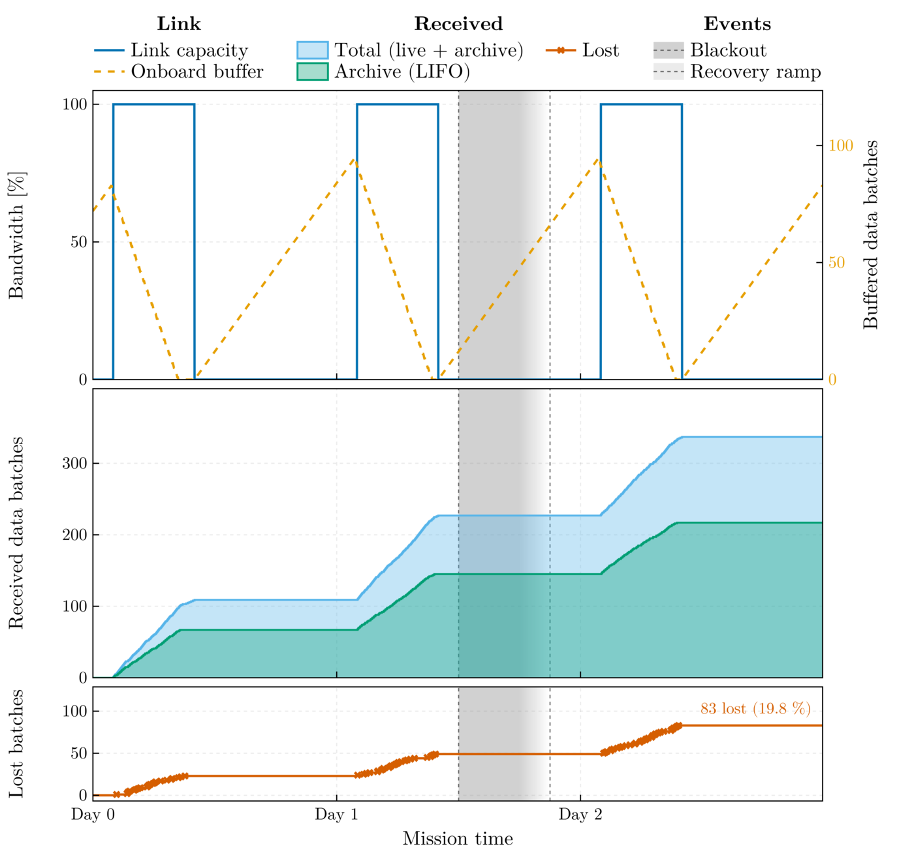
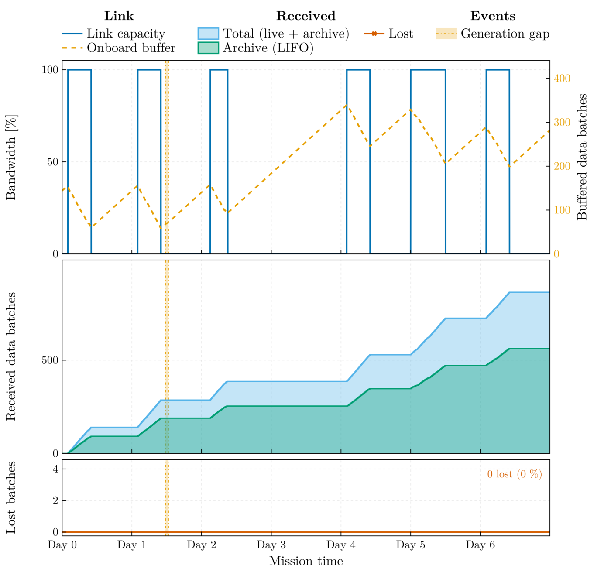
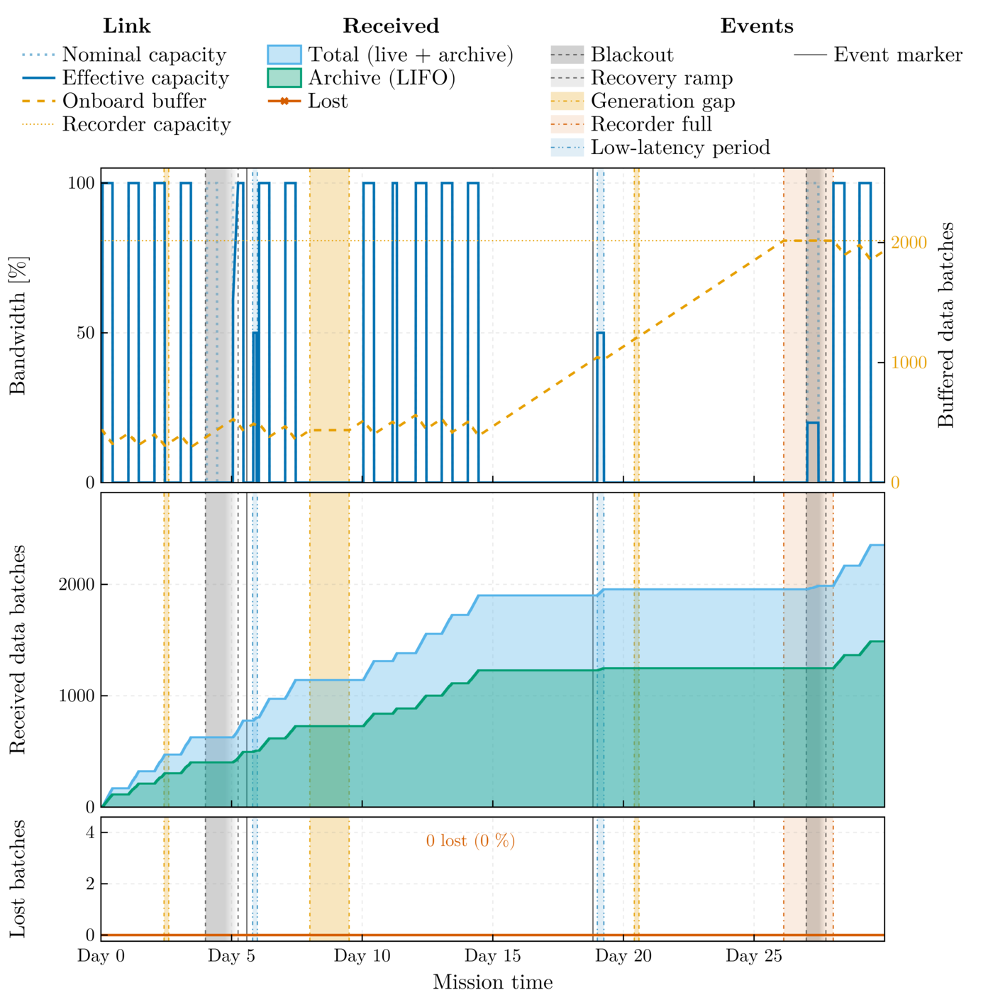
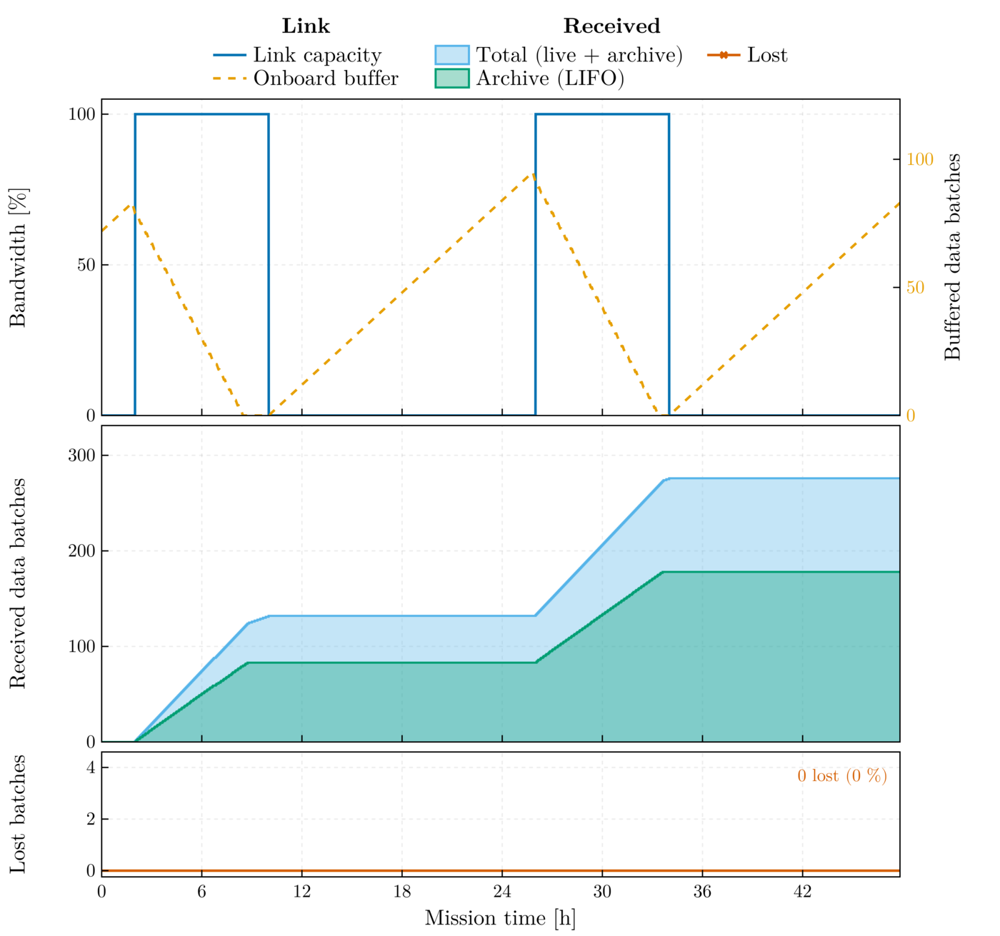

# Scenario library

Every file in this directory is a complete configuration, runnable by path
from the package root:

```bash
julia scripts/run_full_sim.jl <RUN_ID> scenarios/<file>.toml
```

`config.toml` at the package root is the default entry point and a copy of
`recovery_12h_seasonal.toml`. The test suite validates every file here and
runs `smoke_1d.toml` end to end; its reproducibility test runs a shortened,
lossier `deterministic_1d.toml` three times, one seed twice and another
once. Each file documents the safe interval of every key; the rationale of
each scenario is stated below and on the manual's usage page.

## Coverage

Unless stated otherwise a scenario uses the physical link (230 kbit/s
downlink against 75 kbit/s production, a flat profile within the pass, 8 h
daily passes starting 08:00, a 50 × 10⁶ km range), 600 s batches of
the synthetic flag series (4 Hz, 60 s segments, 10 per batch: 144 batches per day),
and a 14-day on-board recorder. GE denotes the Gilbert–Elliott bursty
channel with the shipped parameters (stationary loss 6.25 %). Wall times
are at the configured acceleration, before post-processing (about half a
minute per mission day). Any scenario also runs on the tick clock with
`--tick`, which is how the manual's gallery is made.

| File | Mission | Wall | Capacity, profile | Contacts | Channel | Disruptions, markers | Expected regime |
|---|---|---|---|---|---|---|---|
| `smoke_1d.toml` | 0.5 d | 12 s | physical, flat | 8 h | Bernoulli 1 % | none | one pass drains a 6 h backlog; suite smoke run |
| `nominal_8h.toml` | 7 d | 168 s | physical, flat | 8 h, January | Bernoulli 1 % | none, no backlog | balance: link capacity 145.7 per day against 144 produced; the buffer clears at the end of each pass if the host keeps pace with the accelerated clock, and a slower receiver leaves a residual |
| `stress_8h_bursty.toml` | 7 d | 168 s | physical, flat | 8 h, January | GE | solar flare day 2.5, repointing day 1.5, DSN outage day 5, marker day 4 with a triggered low-latency period; 2-day backlog | growth: 138 delivered against 144 produced per day, plus the disruption debt; buffer from 288 to about 530 batches, 24 h compliance about 58 %; live alert latency bounded by live priority |
| `recovery_12h_seasonal.toml` | 7 d | 168 s | physical, flat | 8 h + 4 h seasonal, 30 March | GE | as the stress scenario, marker 3 April; 2-day backlog | recovery: about 210 batches per 12 h pass against 144 produced per day; the flare and the outage each cost about one pass, and the week still ends below the initial backlog (buffer about 50–300 batches), where the 8 h stress case nearly doubles it |
| `abstraction_gaussian_peak.toml` | 7 d | 168 s | 60 batches/h peak, Gaussian σ = 0.15 | 8 h, January | GE | as the stress scenario | the pre-library default: a peak abstraction with a 0.38 mean factor, 169 delivered per day, a slow drain of the 2-day backlog between the disruptions |
| `backlog_recovery_sine.toml` | 7 d | 168 s | 60 batches/h peak, sine | 8 h, January | Bernoulli 10 % | none; 3-day backlog | backlog recovery over the week under retransmission load |
| `drop_policy.toml` | 3 d | 72 s | physical, flat | 8 h, January | Bernoulli 20 %, drop on loss | partial DSN outage day 1.5; 0.5-day backlog | about one fifth of the transfers lost for good (mask state 4), no retransmission traffic |
| `explicit_schedule.toml` | 7 d | 168 s | physical, flat | explicit pass list: day 2 shortened to 6 h, day 3 missed, day 5 extended to 12 h | GE | repointing day 1.5; 1-day backlog | planned schedules with exceptions; the missed pass produces a two-day gap |
| `long_30d_seasonal.toml` | 30 d | 360 s at 7200× | physical, flat | 8 h + 4 h seasonal from 20 July; passes missed on 28 and 29 July, shortened on 31 July, a 12-day gap 4–15 August | GE | repointing days 2.5 and 20.5, solar flare day 4, 36 h safe mode day 8 (generation), DSN outage day 27; markers 25 July and 8 August with triggered periods; 3-day backlog | long horizon: the recorder ceiling is reached inside the contact gap (validation warns; RECORDER rows), the marker inside the gap opens a low-latency period, three passes drain part of the backlog at the end |
| `long_segments_2400s.toml` | 7 d | 168 s | physical, flat | 8 h, January | Bernoulli 1 % | none; 1-day backlog | 2400 s segments at 0.5 Hz, three per 2 h batch: the coarse-batch regime, 12 batches produced per day and 12.3 deliverable |
| `external_ingest.toml` | 2 d | 48 s | physical, flat | 8 h, January | Bernoulli 1 % | none; 0.5-day backlog | ingestion of the generated example series (`scripts/maintenance/generate_example_strain.jl`, 16 Hz, 75 h) through the same pipeline |
| `deterministic_1d.toml` | 1 d | as fast as the host (tick clock, no pacing) | physical, flat | 8 h, January | Bernoulli 1 % | none; 6 h backlog | `simulation.mode = "tick"`: the same seed reproduces the event logs and the mask timeline to the byte; the smoke scenario's physics over a full day |

The delivered-per-day figures follow from the serial receiver: one batch per
slot of transfer time divided by the profile factor, so a day's capacity is
the link rate times the pass length times the profile mean (flat 1.0, sine
0.5, Gaussian with σ = 0.15: 0.38), reduced by the retransmission fraction.

## Gallery

The mission summary of one tick-mode run of each scenario, the smoke and
the deterministic one-day runs excepted.
Top panel: link capacity and, on the right-hand axis, the onboard buffer;
middle: cumulative batches on the ground; bottom: lost batches. The runs,
their commit, and their platform are recorded in
[`docs/src/assets/PROVENANCE.toml`](../docs/src/assets/PROVENANCE.toml); the
manual's Scenario Gallery chapter adds the other run products (session
figures, batch-state raster, delivery delay, alert latency, animation) and a
reading of every figure.

| | |
|---|---|
|  `nominal_8h.toml` |  `stress_8h_bursty.toml` |
|  `recovery_12h_seasonal.toml` |  `abstraction_gaussian_peak.toml` |
|  `backlog_recovery_sine.toml` |  `drop_policy.toml` |
|  `explicit_schedule.toml` |  `long_30d_seasonal.toml` |
|  `long_segments_2400s.toml` |  `external_ingest.toml` |

## Adding a scenario

Copy the closest file, keep every key with its comment, state the scenario
in the two header lines, and add a row to the table above and to the usage
page; a scenario that is to appear in the gallery also gets an entry in the
table of `docs/render_assets.jl`. The suite's scenario testset validates the
new file automatically.
